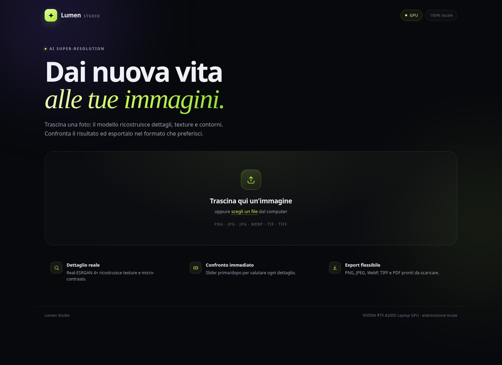
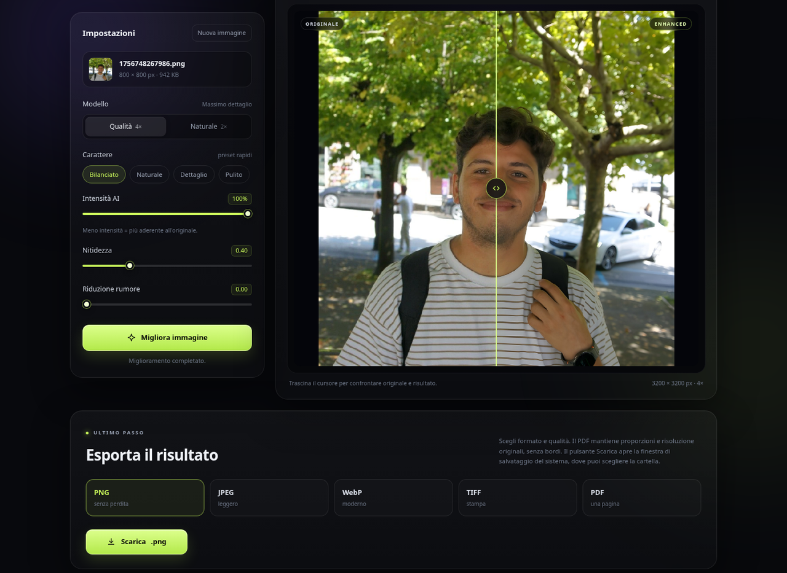

# Lumen Studio

**Migliora e ingrandisci le tue immagini. Senza mandarle da nessuna parte.**


Lumen Studio è una web app locale per il **super-resolution**: trascini una foto,
Real-ESRGAN ricostruisce dettagli e texture, e confronti il risultato con l'originale
prima di esportarlo in PNG, JPEG, WebP, TIFF o PDF. Tutto gira su `127.0.0.1`.





## Cosa fa

- **Super-resolution 4× o 2×** con Real-ESRGAN (spandrel + PyTorch).
- **Confronto prima/dopo** con slider, direttamente nel browser.
- **Preset pronti**: Bilanciato, Naturale, Dettaglio, Pulito.
- **Controlli fini**: intensità AI, nitidezza, riduzione rumore, autocontrast.
- **Tiling a 256 px** con progresso a riquadri: gestisce anche immagini grandi.
- **Export** in PNG lossless, JPEG, WebP, TIFF (LZW) e PDF a 300 DPI.
- **Salvataggio nativo**: su Chrome/Edge apre la finestra di sistema per scegliere
  cartella e nome del file.
- **Coda seriale**: un solo job alla volta, così la GPU non va in conflitto.
- **Pulizia automatica** dei risultati dopo 12 ore (configurabile).
- **GPU o CPU**: rileva CUDA, Apple Silicon o CPU e si adatta.

## Avvio rapido

Prerequisiti: Python 3.10+, `pip` e, per la massima velocità, una GPU con CUDA.
Funziona anche su CPU, semplicemente più lentamente.

```bash
git clone https://github.com/riccardoFus/lumen-studio.git
cd lumen-studio
./run.sh
# → http://127.0.0.1:8790
```

`run.sh` usa `.venv/bin/python` se presente, altrimenti `python3` di sistema.
Se manca la virtualenv:

```bash
python3 -m venv .venv
.venv/bin/pip install -r requirements.txt
./run.sh
```

### Modelli

I pesi **non sono inclusi** nel repository (sono circa 67 MB ciascuno).
Scarica almeno il modello 4×:

```bash
mkdir -p models
wget -O models/RealESRGAN_x4plus.pth \
  https://github.com/xinntao/Real-ESRGAN/releases/download/v0.1.0/RealESRGAN_x4plus.pth
```

Per il modello 2×:

```bash
wget -O models/RealESRGAN_x2plus.pth \
  https://github.com/xinntao/Real-ESRGAN/releases/download/v0.2.1/RealESRGAN_x2plus.pth
```

Puoi anche tenere i modelli altrove e puntarci con `LUMEN_MODELS_DIR`.

### Variabili utili

| Variabile | Default | Descrizione |
|---|---|---|
| `HOST` / `PORT` | `127.0.0.1` / `8790` | indirizzo del server |
| `LUMEN_MODELS_DIR` | `./models` | cartella dei pesi `.pth` |
| `LUMEN_JOBS_DIR` | `./jobs` | risultati temporanei |
| `LUMEN_MAX_UPLOAD_MB` | `40` | dimensione massima upload |
| `LUMEN_MAX_INPUT_PIXELS` | `30 000 000` | megapixel massimi in ingresso |
| `LUMEN_MAX_OUTPUT_PIXELS` | `60 000 000` | megapixel massimi in uscita |
| `LUMEN_JOB_TTL_HOURS` | `12` | scadenza dei risultati |
| `LUMEN_NO_BROWSER` | `0` | `1` per non aprire il browser |

## Struttura

```
Lumen-Studio/
├── app/
│   ├── main.py        # API FastAPI + static files
│   ├── pipeline.py    # inferenza Real-ESRGAN, progress, post-processing
│   ├── jobs.py        # coda job (1 worker GPU) e storage su disco
│   ├── exports.py     # encoder PNG / JPEG / WebP / TIFF / PDF
│   └── config.py      # limiti, formati, path modelli
├── static/
│   ├── index.html
│   ├── css/style.css
│   └── js/app.js
├── tests/selftest.py  # test end-to-end (HTTP)
├── models/            # pesi RealESRGAN (da scaricare, non versionati)
├── jobs/              # risultati temporanei (pulizia automatica)
├── requirements.txt
└── run.sh
```

## Come funziona

1. **Upload** (`POST /api/enhance`, multipart): valida formato e dimensione,
   controlla che il risultato non superi il limite di memoria.
2. **Coda**: un solo job alla volta (la GPU è serializzata), stato e
   percentuale esposti da `GET /api/jobs/{id}`.
3. **Pipeline**: Real-ESRGAN con tiling 256 px (progress a riquadri), poi
   blending con Lanczos (`strength`), resize finale opzionale, denoise,
   autocontrast e unsharp mask.
4. **Master**: il risultato è salvato come PNG senza perdita in `jobs/<id>/`.
5. **Export**: `GET /api/jobs/{id}/export?format=...&quality=...` codifica al
   volo. Il PDF ha una pagina grande quanto l'immagine (300 DPI, nessun bordo).
6. **Salvataggio**: il pulsante *Scarica* apre la **finestra di salvataggio del
   sistema** tramite la File System Access API (`showSaveFilePicker`), così
   scegli cartella e nome del file. Se il browser non supporta l'API
   (Firefox/Safari) si usa il download classico del browser.

## API

| Metodo | Endpoint | Descrizione |
|---|---|---|
| GET | `/api/system` | device, modelli, formati, limiti |
| POST | `/api/enhance` | `file`, `model` (`x4`/`x2`), `strength`, `sharpen`, `denoise`, `autocontrast`, `tile`, `scale` |
| GET | `/api/jobs/{id}` | stato, progresso, dimensioni, tempi |
| GET | `/api/jobs/{id}/original?max=1800` | anteprima JPEG dell'originale |
| GET | `/api/jobs/{id}/preview?max=1800` | anteprima JPEG del risultato |
| GET | `/api/jobs/{id}/export?format=png` | download nel formato richiesto |

## Formati

- **Input**: tutto ciò che Pillow sa aprire (PNG, JPEG, WebP, TIFF, BMP, GIF…).
  HEIC/AVIF richiedono plugin aggiuntivi (`pillow-heif`, `pillow-avif-plugin`).
- **Output**: PNG (lossless), JPEG, WebP, TIFF (LZW), PDF.

## Test

```bash
python3 tests/selftest.py
```

Avvia un server su una porta libera e verifica: pagina e asset, upload in tutti
i formati supportati (incluso PNG con alpha), avanzamento job, anteprime,
export in PNG/JPEG/WebP/TIFF/PDF, proporzioni del PDF, gestione errori
(415/400/404). Non usa la GPU in modo concorrente: usa il modello 2× per
restare veloce.

## Compatibilità del salvataggio

- **Chrome / Edge / Opera** (consigliati): dialog nativo con scelta della
  cartella, anche se il browser è impostato per scaricare senza chiedere.
- **Firefox / Safari**: l'API non esiste; il file viene scaricato nella cartella
  predefinita del browser.
- L'API richiede un **contesto sicuro**: usa `http://127.0.0.1:8790` o
  `localhost`. Se apri l'app da un altro dispositivo via IP di rete, il dialog
  nativo non è disponibile e si attiva il fallback.

## Note

- Il primo job carica il modello in memoria (2–4 s); i successivi lo riusano.
- Immagini molto grandi (es. 12 MP con modello 4×) superano il limite di
  memoria: l'app lo segnala e suggerisce il modello 2×.
- I job vengono rimossi automaticamente dopo `LUMEN_JOB_TTL_HOURS` (e
  comunque all'avvio del server).
